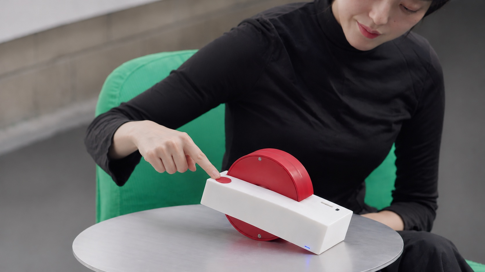
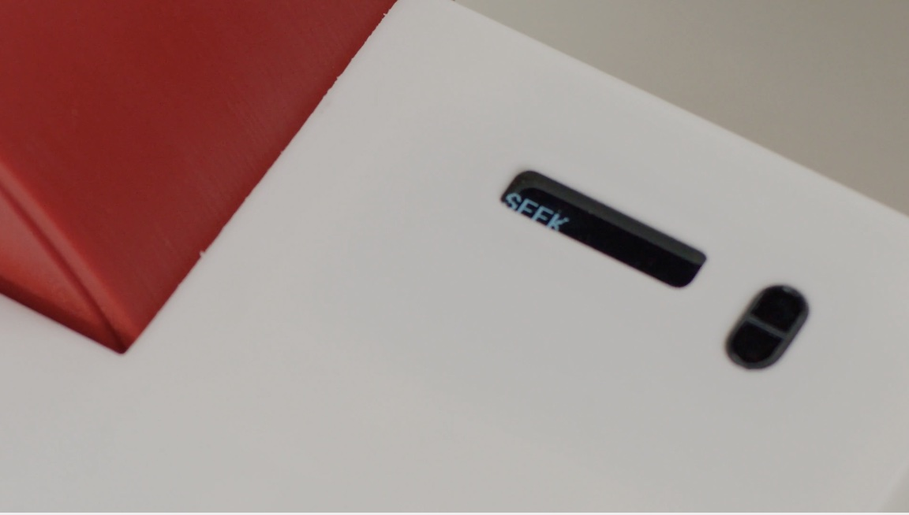
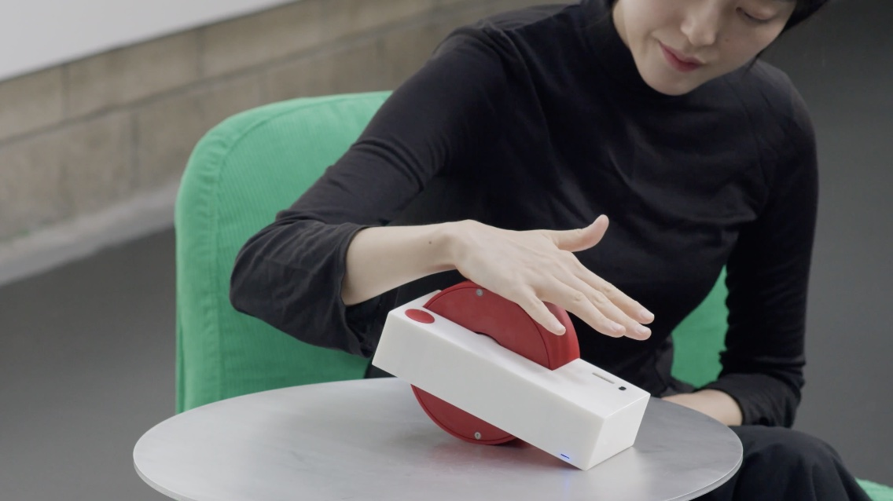
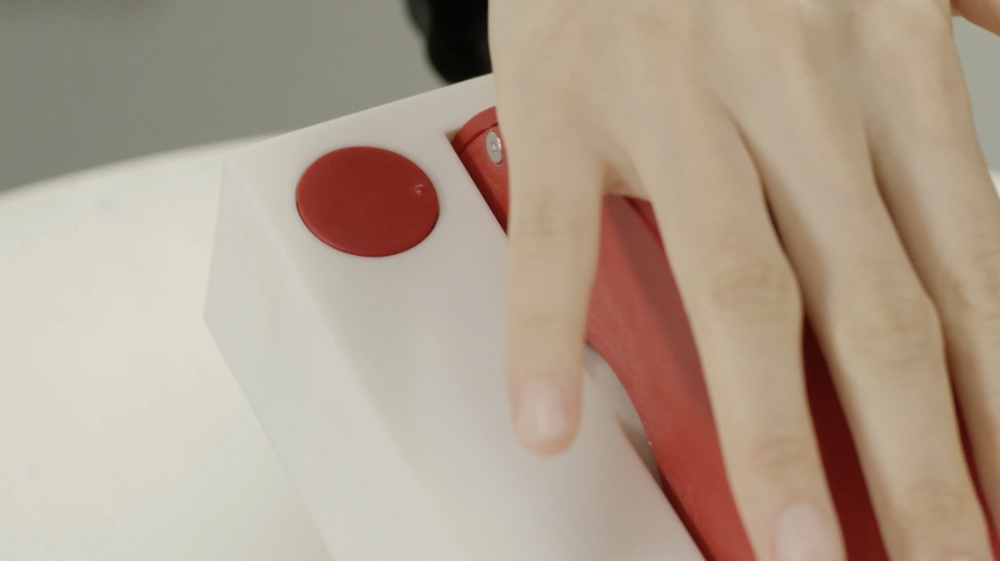
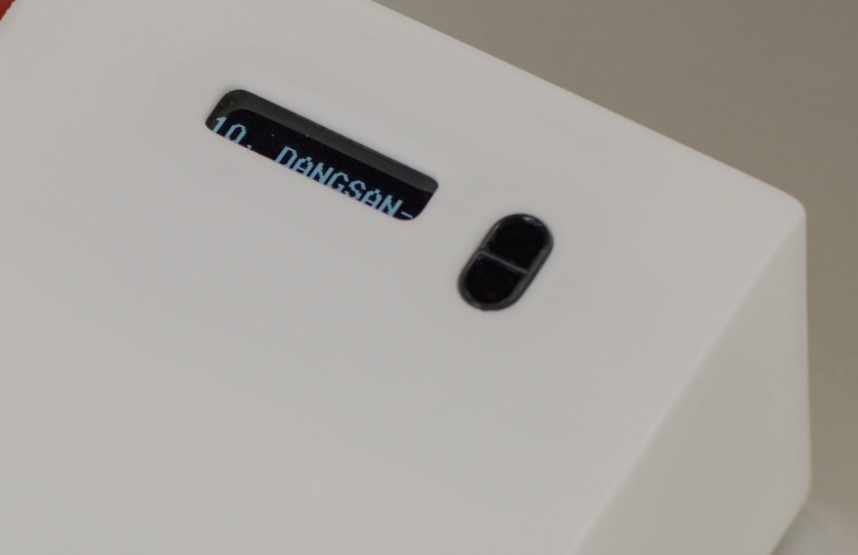
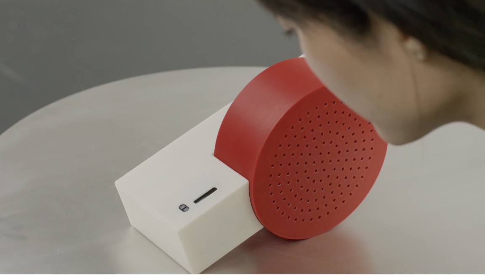
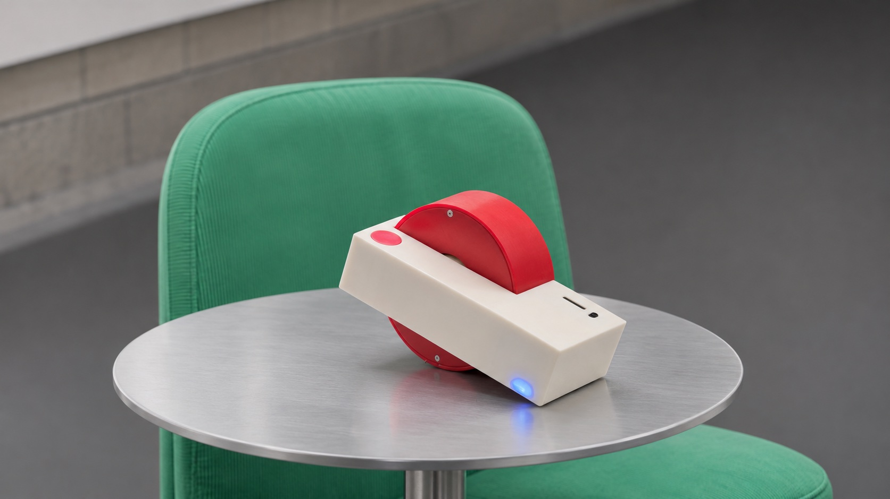

## 플레이어 (NEO Product) 사용 매뉴얼

### 켜기

**1. 전원 켜기**

빨간 버튼을 손가락으로 '딸깍' 소리가 날 때까지 돌립니다. 그보다 더 돌리면 볼륨이 조정됩니다.

**2. 액정 확인**

대략 23초 뒤 상단의 작고 긴 액정 창에 `seek...`이 뜹니다.

`[이미지: 액정 창 00000]`

### 소리 찾기

**3. 휠 돌리기**

켜고 나서 대략 45초쯤 기다린 뒤, 큰 원형의 빨간 휠을 돌립니다. 라디오 주파수를 맞추듯이 돌리면 노이즈가 납니다.

계속 돌리면 '띵' 소리와 함께 액정 창에 주소가 뜨고, 몽환적인 소리가 나는 구간이 나옵니다. 이때 볼륨을 적당히 맞춥니다.

**4. 장소의 주소가 뜨는 구간은 3곳**

사라져 가는 공간의 주소는 모두 3곳에 있습니다.

작은 액정 화면 쪽으로 점점 가까이 가면서 바라보고 있으면 소리는 아주 천천히 원래 소리가 돌아온다.

(30초 이상 걸린다. 일부러 본래의 소리시간성으로 돌아오는 데 시간이 걸리게 하는 게 의도)

---

> **VIP 시연 팁**
>
> 손님이 오기 5분 전쯤 전원만 미리 켜 두세요. (30분 전에도 OK) 50초 뒤 소리가 제대로 나는지 확인하고 볼륨만 줄여 두면 시연할 때 편합니다.
> 평소에는 전원 오프.

> **전원 확인 LED**
>
> 전원이 들어왔는지 확인하려면 아래의 파란색 부분을 확인하세요. (배터리 잔량이 LED 칸으로 표시됨.)

